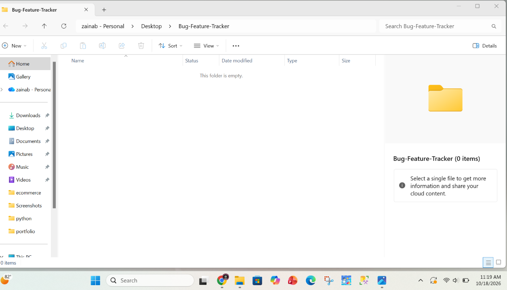
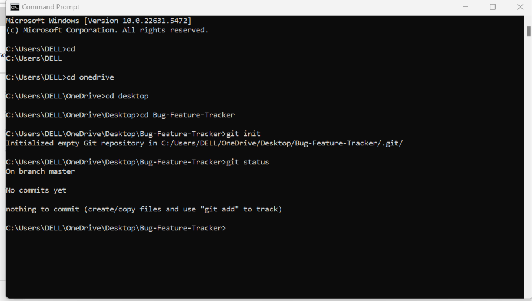
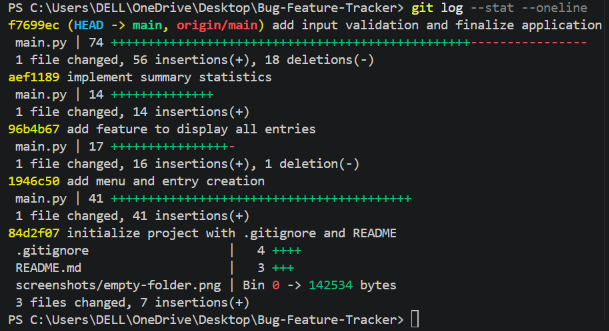
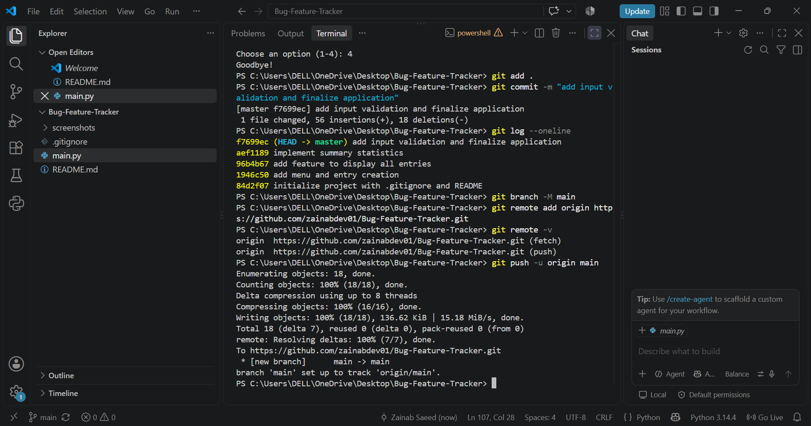
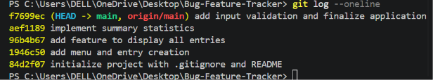

# Bug & Feature Tracker

## Project Description
A simple Python terminal application for recording software bugs and feature requests, viewing them, and checking summary statistics. The focus of this project is practising the Git and GitHub command-line workflow while building a small working program.

## Features
- Add an entry with a title, type (Bug/Feature), priority (Low/Medium/High) and status (Open/Resolved)
- View all entries in a readable table
- Summary statistics: total entries, bugs, feature requests, open and resolved entries
- Simple menu for navigation, with an exit option
- Input validation for invalid menu choices, empty titles and invalid field values, so the program does not crash

## Technologies Used
- Python 3
- Git (command line)
- GitHub

## How to Run
```bash
python main.py
```
Entries are stored in a Python list of dictionaries while the program runs. They are not saved to a file.

## Git Workflow
1. Created an empty local folder `Bug-Feature-Tracker` and an empty GitHub repository with the same name (no README, .gitignore or license).
2. Ran `git init` and `git status` in the project folder.
3. Built the application step by step, using `git add .` and `git commit -m "..."` after each meaningful change.
4. Added a `.gitignore` for `__pycache__/`, `*.pyc`, `.venv/` and `.env`.
5. Renamed the branch with `git branch -M main`, connected GitHub with `git remote add origin <URL>`, checked it with `git remote -v`, and pushed with `git push -u origin main`.
6. Reviewed the history with `git log --oneline`.

## Development History
1. Initialize project with .gitignore and README
2. Add menu and entry creation
3. Add feature to display all entries
4. Implement summary statistics
5. Add input validation and finalize application
6. Improve README and add screenshot evidence

## Screenshots
### Initial Empty Folder





### Git Initialization





### Commits





### Successful Push





### Commit History


